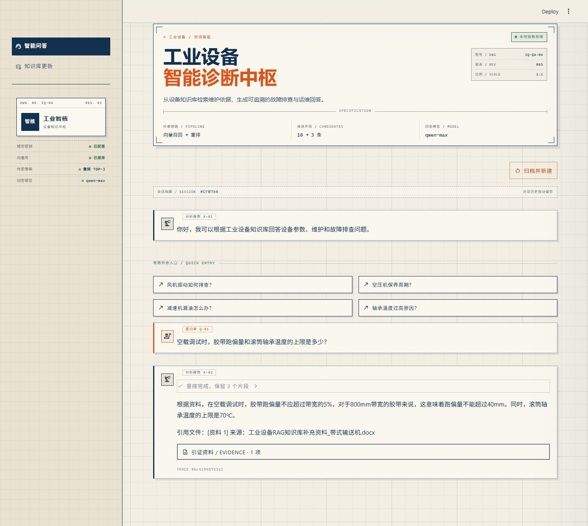
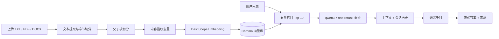

# 工业设备 RAG 智能客服

这是一个面向工业设备知识库的本地 RAG 应用。用户可以上传 TXT、PDF、DOCX
资料，系统完成文本解析、分块、向量化与去重，并在问答页面以流式方式返回答案
和本次检索到的资料来源。

项目基于 Streamlit、LangChain、阿里云百炼 DashScope 和 Chroma 构建，适合作为
智能体应用岗位的 RAG 工程实践展示。

## 界面预览



## 功能

- 支持 TXT、PDF、DOCX 文档入库
- 上传时校验扩展名与基本文件头，降低伪装文件风险
- 按内容 MD5 自动去重，避免重复写入相同资料
- 入库资料带 `doc_id` / `version`，支持按来源替换和删除
- 上传成功状态在页面重跑后保留
- 超长对话历史自动生成抽取式摘要
- 使用 DashScope `text-embedding-v4` 生成向量
- 使用 Chroma 持久化本地向量库
- 使用通义千问 `qwen-max` 进行流式问答
- 每个浏览器会话使用独立 ID，避免用户之间串用聊天记录
- PDF 页码写入向量元数据，回答页面展示引证资料、页码与片段摘录
- 章节感知的父子块：child 约 300 字用于检索，parent 约 800 字用于生成
- 先向量召回 top-10，再用 `qwen3.7-text-rerank` 重排到 top-3，重排失败自动回退
- 每次查询写入 trace：耗时、候选数、fallback 状态与来源，便于排查和统计
- 100 条评测集支持 recall@1/3/5、MRR 与延迟统计，报告可复现
- 资料不足时明确拒答，不编造设备参数或检修步骤
- 文件解析、会话隔离、去重逻辑、重排降级和上下文格式化包含自动化测试

## 评测基线（原始语料）

当前使用 41 条评测集（30 条有答案 + 11 条无答案，含 1 条 hard negative），检索深度 top-10：

| 指标 | 数值 |
| --- | --- |
| recall@1 | 0.633 |
| recall@3 | 0.967 |
| recall@5 | 1.000 |
| MRR | 0.773 |
| P50 检索延迟 | 160 ms（单次测量） |
| P95 检索延迟 | 386 ms（单次测量） |

> 这组数字来自“DOCX 与 PDF 内容重复”的原始语料，指标偏乐观；
> 去重后的结果见下文「语料去重实验」。

相关性判定为「来源文件匹配 + 全部 gold 关键词命中」，匹配前会去掉空白字符，
避免 PDF 换行把关键词拆开。

基线暴露了四个真实问题：

1. PDF 目录页和“使用建议”片段会进入 Top-1，拉低 `recall@1` 与 MRR
2. DOCX/PDF 重复语料让长 chunk 占优，需要按内容去重或来源过滤
3. 有答案与无答案的 Top-1 分数重叠（0.487 vs 0.678），单靠阈值无法稳定拒答
4. 新增 hard negative“机械密封安装扭矩”的 Top-1 分数为 0.581，已接近有答案题，进一步说明阈值不能同时做到不误杀和不漏拒

复现：

```bash
python -m eval.run_eval
```

详细报告见 `eval/report.md`。

### 重排实验（原始重复语料）

历史实验在基线库上先召回 top-10，再用 `gte-rerank-v2` 重排（当前默认模型已升级为
`qwen3.7-text-rerank`）：

| 指标 | 纯向量 | 向量 + 重排 |
| --- | --- | --- |
| recall@1 | 0.633 | **0.800** |
| recall@3 | 0.967 | **1.000** |
| MRR | 0.773 | **0.883** |
| P50 检索延迟 | 160 ms | 281 ms |
| P95 检索延迟 | 386 ms | 516 ms |

重排把 q06、q07、q08 等从第 3–5 名提升到第 1 名，说明问题确实在排序而不是召回。
代价是 P50 增加约 120 ms；延迟为单次测量，受网络波动影响，需多次运行确认。

复现：

```bash
python -m eval.run_eval --rerank
```

### 语料去重实验

原始 DOCX 与 PDF 内容重复，会把指标抬高。为此把旧 DOCX 归档到
`data/archive/`，新增一份与 PDF 不重复的带式输送机资料，并用
PDF + 新 DOCX 建立独立向量库 `chroma_db_dedup`。

评测集仍为原来的 41 条，但 `gold_sources` 只保留 PDF，因为新 DOCX 不再
包含这些题的答案。这样可以直接观察“去掉重复来源”对指标的影响。

| 指标 | 去重纯向量 | 去重 + 重排 |
| --- | --- | --- |
| recall@1 | 0.467 | **0.667** |
| recall@3 | 0.933 | 0.933 |
| recall@5 | 1.000 | 1.000 |
| MRR | 0.700 | **0.811** |
| P50 检索延迟 | 159 ms | 304 ms |

结论：

1. 去掉重复 DOCX 后，纯向量 `recall@1` 从 0.633 降到 0.467，说明重复语料确实让指标偏乐观。
2. 重排在干净语料上仍把 `recall@1` 提升 20pp、MRR 从 0.700 提升到 0.811。
3. `recall@3` 仍为 0.933，q07/q09 的相关片段稳定在第 4，说明重排解决排序，不解决候选噪声或召回缺口。
4. 实验中发现并修复了评测脚本的假阴性：PDF 会在关键词中间插入换行，匹配前需要去掉空白字符。

复现：

```bash
python scripts/build_eval_corpus.py \
  --persist-dir chroma_db_dedup \
  --collection rag_dedup \
  --md5-path md5_text_dedup \
  data/工业设备RAG知识库文本资料汇编.pdf \
  data/工业设备RAG知识库补充资料_带式输送机.docx

CHROMA_PERSIST_DIRECTORY=chroma_db_dedup \
CHROMA_COLLECTION_NAME=rag_dedup \
python -m eval.run_eval --dataset eval/dataset_dedup.jsonl --label dedup_baseline

CHROMA_PERSIST_DIRECTORY=chroma_db_dedup \
CHROMA_COLLECTION_NAME=rag_dedup \
python -m eval.run_eval --dataset eval/dataset_dedup.jsonl --label dedup_rerank --rerank
```

当前本地 `.env` 已指向 `chroma_db_clean_table` / `rag_clean_table`；
`chroma_db_clean`、`chroma_db_structured`、`chroma_db_dedup` 和原始 `chroma_db`
保留，用于复现旧指标和对比实验。

### 新 DOCX 覆盖评测

新增带式输送机资料后，单独构造了 10 条评测题：8 条有答案 + 2 条无答案，
验证新 DOCX 是否真的可检索、可回答。

| 指标 | 纯向量 | 向量 + 重排 |
| --- | ---: | ---: |
| recall@1 | 0.750 | **0.875** |
| recall@3 | 1.000 | 1.000 |
| MRR | 0.854 | **0.917** |
| 有答案 Top-1 平均分 | 0.614 | 0.446 |
| 无答案 Top-1 平均分 | 0.646 | **0.275** |

纯向量下，无答案题的平均分（0.646）甚至高于有答案题（0.614），单靠阈值
无法拒答；重排后两者拉开到 0.446 / 0.275，说明重排不仅改善排序，也为后续
拒答策略提供了更好的分数区分度。

### 混合检索实验（未接入应用）

在去重语料上增加 BM25 + 向量 RRF 混合检索，对比四组策略：

| 指标 | 纯向量 | 向量 + 重排 | BM25 + 向量 | BM25 + 向量 + 重排 |
| --- | ---: | ---: | ---: | ---: |
| recall@1 | 0.467 | **0.667** | 0.600 | **0.667** |
| recall@3 | 0.933 | 0.933 | **1.000** | 0.933 |
| MRR | 0.700 | **0.811** | 0.772 | **0.811** |

关键发现：

1. 混合检索单独使用时，q07/q09 从第 4 名进入第 3 名，`recall@3` 提升到 1.000。
2. 再叠加重排后，q07/q09 又回到第 4，整体指标和“向量 + 重排”持平。
3. 输送机 10 条上同样没有叠加收益：混合单独 `recall@3 = 0.875`，混合 + 重排回到 1.000，与现有方案一致。

结论：混合检索能改善候选召回，但和当前重排不是简单叠加关系。按实验规则
**没有接入应用**，只保留为评测能力：

```bash
python -m eval.run_eval --dataset eval/dataset_dedup.jsonl --label dedup_hybrid --hybrid
python -m eval.run_eval --dataset eval/dataset_dedup.jsonl --label dedup_hybrid_rerank --hybrid --rerank
```

### 100 条评测集 v2

在 51 条基础上扩到 100 条（75 条有答案 + 25 条无答案），覆盖泵、风机、电机、
PLC、输送机、安全规范和维修案例。构建脚本会校验每个关键词确实出现在对应来源中：

```bash
python scripts/build_dataset_v2.py
```

| 指标 | 纯向量 | 向量 + 重排 | 混合 | 混合 + 重排 |
| --- | ---: | ---: | ---: | ---: |
| recall@1 | 0.507 | 0.693 | 0.600 | **0.707** |
| recall@3 | 0.947 | 0.960 | 0.920 | **0.973** |
| recall@5 | 0.973 | 0.987 | 0.987 | **1.000** |
| MRR | 0.702 | 0.818 | 0.760 | **0.831** |

解读：

1. 样本扩大后，重排仍把 `recall@1` 从 0.507 提升到 0.693，方向稳定。
2. 混合 + 重排只比“向量 + 重排”多约 1 道题，主要来自 `s02` 被混合召回救回；
   不能据此宣称显著提升。
3. q07/q09 在混合 + 重排下仍排第 4，说明还需要查询拆解或父子块，而不是继续堆检索器。

### 重排模型升级：qwen3-rerank

`gte-rerank-v2` 的免费额度耗尽后，测试了百炼的 `qwen3-rerank`，接口兼容现有
`TextReRank.call`，无需改调用代码：

| 指标 | gte-rerank-v2 | qwen3-rerank |
| --- | ---: | ---: |
| recall@1 | 0.693 | **0.787** |
| recall@3 | **0.960** | 0.947 |
| recall@5 | 0.987 | 0.987 |
| MRR | 0.818 | **0.868** |
| P50 延迟 | 296 ms | 345 ms |
| P95 延迟 | 568 ms | 451 ms |

关键变化：

- q07 从第 4 升到第 3，q09 从第 4 升到第 2，c02 保持第 3。
- `recall@1` 提升 9.3pp，MRR 提升 0.05；`recall@3` 略降 1.3pp，整体更偏向 Top-1。
- 有答案 Top-1 平均分 0.846，无答案 0.584，分数区分度比旧模型更好。
- 查询拆解 + qwen3 重排 top5 与直接重排完全一致，拆解没有叠加收益。

随后继续测试 `qwen3.7-text-rerank`：

| 指标 | qwen3-rerank | qwen3.7-text-rerank |
| --- | ---: | ---: |
| recall@1 | 0.787 | **0.987** |
| recall@3 | 0.947 | **1.000** |
| recall@5 | 0.987 | **1.000** |
| MRR | 0.868 | **0.993** |
| P50 延迟 | 345 ms | 308 ms |
| P95 延迟 | 451 ms | 467 ms |

q07/q09/c02 全部到第 1；有答案 Top-1 平均分 0.982，无答案 0.465，分数区分度进一步拉开。

当前默认模型已切换为 `qwen3.7-text-rerank`；`qwen3-rerank` 和 `gte-rerank-v2`
的结果保留为历史对照。

### 结构化父子块（已接入）

按章节标题切 section，再把 section 切成约 800 字的 parent 和约 300 字的 child。
检索和重排使用 child，命中后展开为 parent 交给大模型。

| 指标 | 去重库 + qwen3 | 结构化库，纯向量 | 结构化库 + qwen3 |
| --- | ---: | ---: | ---: |
| recall@1 | 0.787 | 0.787 | **0.907** |
| recall@3 | 0.947 | 0.907 | **0.987** |
| recall@5 | 0.987 | 1.000 | 1.000 |
| MRR | 0.868 | 0.863 | **0.945** |

关键变化：

- q07：第 3 → **第 2**
- q09：第 2 → **第 2**
- c02：第 3 → **第 1**
- `recall@1` 提升 12pp，`recall@3` 提升 4pp，MRR 提升 0.077

结论：长块和表格被章节切分后，检索粒度和生成上下文同时改善。

### 目录/前言清洗（已接入）

在父子块基础上，过滤封面、目录页、前言和“入库建议”等非知识内容：

| 指标 | 结构化 + qwen3 | 清洗 + 纯向量 | 清洗 + qwen3 |
| --- | ---: | ---: | ---: |
| recall@1 | 0.907 | 0.840 | **0.920** |
| recall@3 | 0.987 | 1.000 | 0.987 |
| recall@5 | 1.000 | 1.000 | 1.000 |
| MRR | 0.945 | 0.909 | **0.957** |

清理后 child 数量从 55 降到 34，减少了目录页、封面和前言片段的干扰。
当前应用已切换到 `chroma_db_clean_table`。

复现：

```bash
python scripts/build_eval_corpus.py \
  --persist-dir chroma_db_structured \
  --collection rag_structured \
  --md5-path md5_text_structured \
  data/工业设备RAG知识库文本资料汇编.pdf \
  data/工业设备RAG知识库补充资料_带式输送机.docx

CHROMA_PERSIST_DIRECTORY=chroma_db_structured \
CHROMA_COLLECTION_NAME=rag_structured \
python -m eval.run_eval --dataset eval/dataset_v2.jsonl --label v2_structured_rerank --rerank
```

### 答案级评测与拒答（P004/P015）

检索指标只能说明“找到了”，答案级评测检查“答对了没有”：

- 关键词覆盖率
- 全部关键词是否命中
- 引用来源是否命中
- 有答案题是否误拒答
- 无答案题是否正确拒答
- 按 Top-1 分数扫描拒答阈值

完整 100 条（75 有答案 + 25 无答案，qwen3.7 重排，重排全部成功）：

| 指标 | 数值 |
| --- | ---: |
| 关键词覆盖率 | 0.962 |
| 全部关键词命中率 | 0.920 |
| 来源命中率 | 1.000 |
| 回答引用来源率 | 0.853 |
| 有答案误拒答率 | 0.000 |
| 无答案正确拒答率 | 0.800 |

阈值扫描中，阈值 0.7 时有答案误拒答 0%、无答案拒答 96%；阈值 0.6 时无答案拒答 76%。这说明 qwen3.7 的分数分布已经比较适合阈值拒答，但仍需要答案级校验兜底。

### 拒答路由（P015）

上面的阈值扫描只是事后模拟。生成前真正的拦截在 `rag.py` 的 `should_refuse()`：

- 阈值 0.75，dev 集扫描、test 集验证。dev 有答案最低 0.813、无答案最高 0.690；0.70 / 0.75 / 0.78 / 0.80 四档指标完全相同，取中点 0.75，两侧各留 0.06 安全边际
- 只对 `rerank_status == "success"` 的重排分生效。降级时 `top_score` 是向量相似度，尺子不同，不套用阈值，交给提示词兜底
- 应用和评测共用同一函数，避免两套实现漂移

test 集 44 条（32 有答案 + 12 无答案）开关对比：

| 指标 | 关闭路由 | 开启路由 |
| --- | ---: | ---: |
| 有答案误拒 | 0.000 | 0.000 |
| 无答案拒答 | 0.500 (6/12) | 0.917 (11/12) |
| 关键词覆盖 | 0.943 | 0.943 |
| 回答引用来源 | 0.812 | 0.812 |

拒答路径不调用生成模型，无答案问题的端到端耗时从约 7 秒降到约 1 秒。仍有 1 道题拒不掉（u09，分数 0.846），属于真实重叠，单阈值无法解决。

复现：

```bash
python -m eval.run_answer_eval --dataset eval/dataset_v2_test.jsonl \
  --answerable-limit 100 --unanswerable-limit 100 \
  --report eval/answer_report_test_route.md --results eval/answer_results_test_route.jsonl

python -m eval.run_answer_eval --dataset eval/dataset_v2_test.jsonl \
  --answerable-limit 100 --unanswerable-limit 100 --no-refusal \
  --report eval/answer_report_test_noroute.md --results eval/answer_results_test_noroute.jsonl
```

失败样例：6 道有答案题没有命中全部关键词，11 道回答没有显式引用来源，5 道无答案题仍被回答；这些都是下一步要处理的重点。

复现：

```bash
python -m eval.run_answer_eval --answerable-limit 75 --unanswerable-limit 25
```

### dev/test 划分

```bash
python scripts/split_dataset.py
```

输出 56 条 dev + 44 条 test，使用稳定哈希，重复运行结果一致。调参只看 dev，最终结论看 test。

### 查询拆解实验（未接入）

规则式拆解把“原因 + 处理”“A 和 B 是多少”拆成子问题，分别检索后用 RRF 融合：

| 指标 | 纯向量 | 查询拆解 | 拆解 + 混合 | 拆解 + qwen3 重排 top5 |
| --- | ---: | ---: | ---: | ---: |
| recall@1 | 0.507 | 0.520 | 0.573 | **0.787** |
| recall@3 | 0.947 | 0.947 | 0.907 | 0.947 |
| recall@5 | 0.973 | 0.973 | 0.987 | 0.987 |
| MRR | 0.702 | 0.704 | 0.745 | **0.868** |

结论：

1. 规则拆解单独只多命中 1 道题，提升很小。
2. 拆解 + 混合把 q07 提到第 3，但 q09 仍在第 4，c02 到第 5。
3. 拆解 + qwen3 重排 top5 与直接 qwen3 重排完全一致，没有叠加收益。
4. 因此拆解没有接入应用；下一步应尝试 LLM 拆解或父子块，而不是继续调规则。

## 架构



## 项目结构

```text
.
├── app.py                  # Streamlit 单入口
├── app_qa.py               # 智能问答页面
├── app_file_upload.py      # 知识库更新页面
├── ui_theme.py             # 蓝图工程档案主题和页面视觉组件
├── file_parsers.py         # TXT / PDF / DOCX 文本提取
├── chunking.py             # 章节感知的父子块切分
├── knowledge_base.py       # 文档入库、向量化和去重
├── rag.py                  # 检索、Prompt、模型与流式链路
├── rerank.py               # DashScope 文本重排
├── hybrid.py               # BM25 + 向量 RRF 混合检索（评测用）
├── query_decompose.py      # 多部分问题规则拆解（评测用）
├── observability.py        # 查询 trace 与 JSONL 日志
├── vector_stores.py        # Chroma 向量库适配
├── file_history_store.py   # 本地会话历史
├── config_data.py          # 环境变量和路径配置
├── data/                   # 示例知识库原始资料
│   └── archive/            # 旧版重复 DOCX，保留用于复现实验
├── eval/                   # 评测集、检索指标与基线报告
├── scripts/                # 独立评测语料构建脚本
├── docs/                   # README 界面预览
└── tests/                  # 自动化测试
```

本地生成的 `chroma_db/`、`chat_history/` 和 `md5_text` 已加入 `.gitignore`，
不会被提交到 GitHub。

## 快速开始

建议使用 Python 3.11 或更高版本；当前代码已在 Python 3.13 下完成测试。

### Windows PowerShell

```powershell
py -3 -m venv .venv
.\.venv\Scripts\Activate.ps1
python -m pip install --upgrade pip
python -m pip install -r requirements.txt
Copy-Item .env.example .env
```

打开 `.env`，填写阿里云百炼 API Key：

```dotenv
DASHSCOPE_API_KEY=你的_API_Key
```

启动应用：

```powershell
streamlit run app.py
```

### macOS / Linux

```bash
python3 -m venv .venv
source .venv/bin/activate
python -m pip install --upgrade pip
python -m pip install -r requirements.txt
cp .env.example .env
streamlit run app.py
```

## 使用方式

1. 打开“知识库更新”页面，上传资料并点击“加入知识库”。
2. 等待文本解析、向量化和去重完成。
3. 回到“智能问答”页面，输入设备参数、维护或故障排查问题。
4. 展开回答下方的“引证资料 / EVIDENCE”查看本次命中的来源与页码。

项目目录中的 `data/` 已提供一份示例资料。重新建立本地知识库时，可以直接通过
上传页面写入；随后删除 `chroma_db/` 和 `md5_text` 也可以从空知识库重新开始。

## 配置

所有可调参数都可以通过 `.env` 或系统环境变量覆盖：

| 变量 | 默认值 | 说明 |
| --- | --- | --- |
| `DASHSCOPE_API_KEY` | 无 | 必填，阿里云百炼 API Key |
| `CHAT_MODEL_NAME` | `qwen-max` | 回答模型 |
| `EMBEDDING_MODEL_NAME` | `text-embedding-v4` | 向量模型 |
| `RETRIEVAL_TOP_K` | `3` | 纯向量检索返回的片段数 |
| `MAX_HISTORY_MESSAGES` | `20` | 进入 Prompt 的最近消息条数 |
| `RERANK_ENABLED` | `true` | 是否启用重排；失败时自动回退 |
| `RERANK_MODEL` | `qwen3.7-text-rerank` | 重排模型 |
| `RERANK_TOP_N` | `3` | 重排后保留的片段数 |
| `RERANK_CANDIDATE_K` | `10` | 进入重排的候选片段数 |
| `RERANK_TIMEOUT_SECONDS` | `3` | 本地等待重排的上限 |
| `RERANK_FAILURE_THRESHOLD` | `3` | 连续失败多少次后熔断 |
| `RERANK_COOLDOWN_SECONDS` | `60` | 熔断冷却时间 |
| `HYBRID_BM25_K` | `10` | BM25 召回的候选数（评测用） |
| `HYBRID_RRF_K` | `60` | RRF 融合常数（评测用） |
| `CHUNK_SIZE` | `300` | child 分块长度（用于检索） |
| `CHUNK_OVERLAP` | `50` | child 分块重叠长度 |
| `PARENT_CHUNK_SIZE` | `800` | parent 分块长度（用于生成） |
| `PARENT_CHUNK_OVERLAP` | `100` | parent 分块重叠长度 |
| `MAX_UPLOAD_SIZE_MB` | `10` | 应用层单文件大小限制 |
| `QA_LOG_PATH` | `logs/qa.jsonl` | 查询 trace 落盘路径 |
| `OBSERVABILITY_ENABLED` | `true` | 是否写入查询 trace |

修改 `MAX_UPLOAD_SIZE_MB` 时，请同步调整 `.streamlit/config.toml` 中的
`maxUploadSize`，避免上传框提示与后端校验不一致。

服务默认只监听本机 `127.0.0.1`。如需局域网访问，将 `.streamlit/config.toml`
中的 `server.address` 改为 `0.0.0.0`，或在启动时加
`--server.address 0.0.0.0`，并确认网络环境可信。

模型调用会产生费用，请根据自己的百炼账户额度控制使用量。

## 测试

```powershell
python -m pip install -r requirements-dev.txt
python -m pytest -q
```

测试不需要调用模型 API，覆盖文本编码、PDF/DOCX 解析、会话 ID 校验、历史读写、
内容去重、RAG 上下文格式化、查询 trace、评测指标，以及问答页和上传页的
Streamlit 启动。

检索基线评测需要调用 Embedding API：

```powershell
python -m eval.run_eval
```

仓库包含 GitHub Actions 工作流，在推送和拉取请求时使用 Python 3.11 与 3.13
执行编译和测试。

## 可观测性

每次问答会向 `logs/qa.jsonl` 追加一条 trace：

```json
{
  "trace_id": "fd84d47d39c5",
  "candidate_count": 10,
  "returned_count": 3,
  "retrieval_ms": 777.8,
  "rerank_ms": 176.8,
  "generation_ms": 6050.8,
  "rerank_status": "success",
  "fallback": false,
  "top_sources": ["工业设备RAG知识库文本资料汇编.pdf p.4"],
  "answer_chars": 250
}
```

`rerank_status` 可能是 `success`、`fallback`、`circuit_open`、`disabled` 或 `empty`。
不记录完整问题和回答正文，只记录长度、来源和耗时，降低敏感资料落盘风险。

统计：

```bash
python scripts/qa_stats.py --log logs/qa.jsonl
```

输出查询总数、重排状态、fallback 次数与比例、候选/返回数、检索/重排/生成 P50/P95。

## 设计说明

- **相对路径配置**：所有本地路径基于项目根目录生成，也可以通过环境变量替换。
- **会话隔离**：Streamlit 为每个浏览器会话生成随机 ID，历史文件不接受路径字符。
- **原子写入**：聊天历史先写入临时文件再替换目标文件，降低文件损坏概率。
- **资料不足回退**：Prompt 明确要求在缺少依据时拒绝编造，页面同时展示引证资料与页码。
- **重排降级**：重排最多等待 3 秒；连续失败 3 次后熔断 60 秒，熔断期间直接使用向量 Top-K。
- **上传保护**：应用检查扩展名、基本文件头和文件大小；扫描版 PDF 没有文本时会提示先做 OCR。

## 已知限制

- 当前是本地单进程演示版，没有登录、权限管理和数据库级会话隔离。
- Chroma 和聊天历史保存在本地磁盘，不适合直接部署为多实例生产服务。
- 扫描版 PDF 尚未集成 OCR。
- 已接入章节感知的父子块和“向量召回 + qwen3 重排”；BM25 混合检索已验证，但与重排不是简单叠加，暂未接入应用。
- 父子块目前按标题和文本行切分，表格 schema 还没有完整结构化，复杂跨页表格仍需 P021 继续处理。
- 评测集只有 41 条，且新加入的带式输送机 DOCX 还没有对应题目，结论需要继续扩充样本复验。
- 新的带式输送机 DOCX 是 RAG 评测用示例资料，不是厂商正式手册，参数不能直接用于现场施工。
- 修复前入库的历史向量没有 `page` 元数据；页面会尝试从正文的 `[第 N 页]`
  标记回退识别，重新入库可获得完整页码。
- 当前没有文档级权限控制、Prompt 注入过滤和模型输出内容审核，不应用于处理
  未授权的敏感设备资料。
- 通义模型接入当前仍依赖 `langchain-community`；官方独立包暂未覆盖本项目的
  Python 3.13 安装环境，后续应随官方兼容版本迁移。

## 数据与隐私

`.env`、聊天历史、Chroma 数据库和去重状态不会提交到 GitHub。提交前仍应使用
Git 暂存区检查是否包含个人或企业敏感资料。

`data/` 中的知识库文档不包含在代码的 MIT 许可证范围内。如果这些资料不是你有权
公开分发的内容，请在公开仓库前删除或替换为自行编写的演示资料。

## License

代码使用 MIT License，详见 [LICENSE](LICENSE)。
