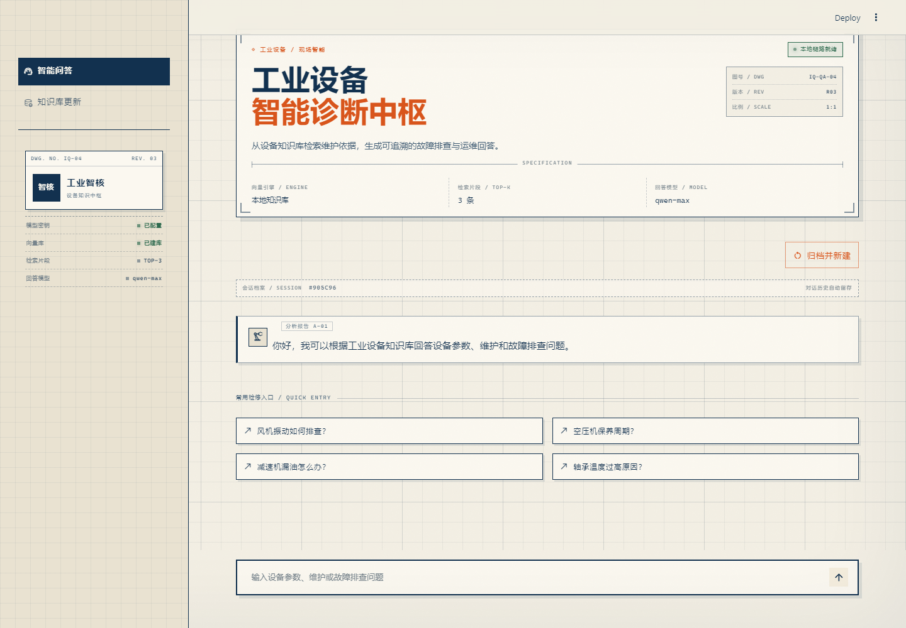
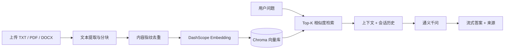

# 工业设备 RAG 智能客服

这是一个面向工业设备知识库的本地 RAG 应用。用户可以上传 TXT、PDF、DOCX
资料，系统完成文本解析、分块、向量化与去重，并在问答页面以流式方式返回答案
和本次检索到的资料来源。

项目基于 Streamlit、LangChain、阿里云百炼 DashScope 和 Chroma 构建，适合作为
智能体应用岗位的 RAG 工程实践展示。

## 界面预览



## 功能

- 支持 TXT、PDF、DOCX 文档入库
- 按内容 MD5 自动去重，避免重复写入相同资料
- 使用 DashScope `text-embedding-v4` 生成向量
- 使用 Chroma 持久化本地向量库
- 使用通义千问 `qwen-max` 进行流式问答
- 每个浏览器会话使用独立 ID，避免用户之间串用聊天记录
- PDF 页码写入向量元数据，回答页面展示引证资料、页码与片段摘录
- 资料不足时明确拒答，不编造设备参数或检修步骤
- 文件解析、会话隔离、去重逻辑和上下文格式化包含自动化测试

## 架构



## 项目结构

```text
.
├── app.py                  # Streamlit 单入口
├── app_qa.py               # 智能问答页面
├── app_file_upload.py      # 知识库更新页面
├── ui_theme.py             # 蓝图工程档案主题和页面视觉组件
├── file_parsers.py         # TXT / PDF / DOCX 文本提取
├── knowledge_base.py       # 文档分块、向量化和去重
├── rag.py                  # 检索、Prompt、模型与流式链路
├── vector_stores.py        # Chroma 向量库适配
├── file_history_store.py   # 本地会话历史
├── config_data.py          # 环境变量和路径配置
├── data/                   # 示例知识库原始资料
├── docs/                   # README 界面预览
└── tests/                  # 自动化测试
```

本地生成的 `chroma_db/`、`chat_history/` 和 `md5_text` 已加入 `.gitignore`，
不会被提交到 GitHub。

## 快速开始

建议使用 Python 3.11 或更高版本；当前代码已在 Python 3.13 下完成测试。

### Windows PowerShell

```powershell
py -3 -m venv .venv
.\.venv\Scripts\Activate.ps1
python -m pip install --upgrade pip
python -m pip install -r requirements.txt
Copy-Item .env.example .env
```

打开 `.env`，填写阿里云百炼 API Key：

```dotenv
DASHSCOPE_API_KEY=你的_API_Key
```

启动应用：

```powershell
streamlit run app.py
```

### macOS / Linux

```bash
python3 -m venv .venv
source .venv/bin/activate
python -m pip install --upgrade pip
python -m pip install -r requirements.txt
cp .env.example .env
streamlit run app.py
```

## 使用方式

1. 打开“知识库更新”页面，上传资料并点击“加入知识库”。
2. 等待文本解析、向量化和去重完成。
3. 回到“智能问答”页面，输入设备参数、维护或故障排查问题。
4. 展开回答下方的“引证资料 / EVIDENCE”查看本次命中的来源与页码。

项目目录中的 `data/` 已提供一份示例资料。重新建立本地知识库时，可以直接通过
上传页面写入；随后删除 `chroma_db/` 和 `md5_text` 也可以从空知识库重新开始。

## 配置

所有可调参数都可以通过 `.env` 或系统环境变量覆盖：

| 变量 | 默认值 | 说明 |
| --- | --- | --- |
| `DASHSCOPE_API_KEY` | 无 | 必填，阿里云百炼 API Key |
| `CHAT_MODEL_NAME` | `qwen-max` | 回答模型 |
| `EMBEDDING_MODEL_NAME` | `text-embedding-v4` | 向量模型 |
| `RETRIEVAL_TOP_K` | `3` | 每次检索返回的片段数 |
| `CHUNK_SIZE` | `300` | 文本分块长度 |
| `CHUNK_OVERLAP` | `50` | 分块重叠长度 |
| `MAX_UPLOAD_SIZE_MB` | `10` | 应用层单文件大小限制 |

修改 `MAX_UPLOAD_SIZE_MB` 时，请同步调整 `.streamlit/config.toml` 中的
`maxUploadSize`，避免上传框提示与后端校验不一致。

模型调用会产生费用，请根据自己的百炼账户额度控制使用量。

## 测试

```powershell
python -m pip install -r requirements-dev.txt
python -m pytest -q
```

测试不需要调用模型 API，覆盖文本编码、PDF/DOCX 解析、会话 ID 校验、历史读写、
内容去重、RAG 上下文格式化，以及问答页和上传页的 Streamlit 启动。

仓库包含 GitHub Actions 工作流，在推送和拉取请求时使用 Python 3.11 与 3.13
执行编译和测试。

## 设计说明

- **相对路径配置**：所有本地路径基于项目根目录生成，也可以通过环境变量替换。
- **会话隔离**：Streamlit 为每个浏览器会话生成随机 ID，历史文件不接受路径字符。
- **原子写入**：聊天历史先写入临时文件再替换目标文件，降低文件损坏概率。
- **资料不足回退**：Prompt 明确要求在缺少依据时拒绝编造，页面同时展示引证资料与页码。
- **上传保护**：应用检查扩展名和文件大小；扫描版 PDF 没有文本时会提示先做 OCR。

## 已知限制

- 当前是本地单进程演示版，没有登录、权限管理和数据库级会话隔离。
- Chroma 和聊天历史保存在本地磁盘，不适合直接部署为多实例生产服务。
- 扫描版 PDF 尚未集成 OCR。
- 检索只使用向量相似度，没有加入重排序、混合检索和自动评测集。
- 修复前入库的历史向量没有 `page` 元数据；页面会尝试从正文的 `[第 N 页]`
  标记回退识别，重新入库可获得完整页码。
- 当前没有文档级权限控制、Prompt 注入过滤和模型输出内容审核，不应用于处理
  未授权的敏感设备资料。
- 通义模型接入当前仍依赖 `langchain-community`；官方独立包暂未覆盖本项目的
  Python 3.13 安装环境，后续应随官方兼容版本迁移。

## 数据与隐私

`.env`、聊天历史、Chroma 数据库和去重状态不会提交到 GitHub。提交前仍应使用
Git 暂存区检查是否包含个人或企业敏感资料。

`data/` 中的知识库文档不包含在代码的 MIT 许可证范围内。如果这些资料不是你有权
公开分发的内容，请在公开仓库前删除或替换为自行编写的演示资料。

## License

代码使用 MIT License，详见 [LICENSE](LICENSE)。
