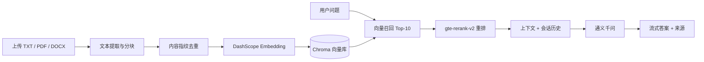

# 工业设备 RAG 智能客服

这是一个面向工业设备知识库的本地 RAG 应用。用户可以上传 TXT、PDF、DOCX
资料，系统完成文本解析、分块、向量化与去重，并在问答页面以流式方式返回答案
和本次检索到的资料来源。

项目基于 Streamlit、LangChain、阿里云百炼 DashScope 和 Chroma 构建，适合作为
智能体应用岗位的 RAG 工程实践展示。

## 界面预览


## 功能

- 支持 TXT、PDF、DOCX 文档入库
- 上传时校验扩展名与基本文件头，降低伪装文件风险
- 按内容 MD5 自动去重，避免重复写入相同资料
- 使用 DashScope `text-embedding-v4` 生成向量
- 使用 Chroma 持久化本地向量库
- 使用通义千问 `qwen-max` 进行流式问答
- 每个浏览器会话使用独立 ID，避免用户之间串用聊天记录
- PDF 页码写入向量元数据，回答页面展示引证资料、页码与片段摘录
- 先向量召回 top-10，再用 `gte-rerank-v2` 重排到 top-3，重排失败自动回退
- 41 条评测集支持 recall@1/3/5、MRR 与延迟统计，报告可复现
- 资料不足时明确拒答，不编造设备参数或检修步骤
- 文件解析、会话隔离、去重逻辑、重排降级和上下文格式化包含自动化测试

## 评测基线（原始语料）

当前使用 41 条评测集（30 条有答案 + 11 条无答案，含 1 条 hard negative），检索深度 top-10：

| 指标 | 数值 |
| --- | --- |
| recall@1 | 0.633 |
| recall@3 | 0.967 |
| recall@5 | 1.000 |
| MRR | 0.773 |
| P50 检索延迟 | 155 ms（单次测量） |
| P95 检索延迟 | 400 ms（单次测量） |

> 这组数字来自“DOCX 与 PDF 内容重复”的原始语料，指标偏乐观；
> 去重后的结果见下文「语料去重实验」。

相关性判定为「来源文件匹配 + 全部 gold 关键词命中」，匹配前会去掉空白字符，
避免 PDF 换行把关键词拆开。

基线暴露了四个真实问题：

1. PDF 目录页和“使用建议”片段会进入 Top-1，拉低 `recall@1` 与 MRR
2. DOCX/PDF 重复语料让长 chunk 占优，需要按内容去重或来源过滤
3. 有答案与无答案的 Top-1 分数重叠（0.487 vs 0.678），单靠阈值无法稳定拒答
4. 新增 hard negative“机械密封安装扭矩”的 Top-1 分数为 0.581，已接近有答案题，进一步说明阈值不能同时做到不误杀和不漏拒

复现：

```bash
python -m eval.run_eval
```

详细报告见 `eval/report.md`。

### 重排实验（原始重复语料）

在基线库上先召回 top-10，再用 `gte-rerank-v2` 重排：

| 指标 | 纯向量 | 向量 + 重排 |
| --- | --- | --- |
| recall@1 | 0.633 | **0.800** |
| recall@3 | 0.967 | **1.000** |
| MRR | 0.773 | **0.883** |
| P50 检索延迟 | 155 ms | 298 ms |
| P95 检索延迟 | 400 ms | 408 ms |

重排把 q06、q07、q08 等从第 3–5 名提升到第 1 名，说明问题确实在排序而不是召回。
代价是 P50 增加约 140 ms；P95 为单次测量，需多次运行确认。

复现：

```bash
python -m eval.run_eval --rerank
```

### 语料去重实验

原始 DOCX 与 PDF 内容重复，会把指标抬高。为此把旧 DOCX 归档到
`data/archive/`，新增一份与 PDF 不重复的带式输送机资料，并用
PDF + 新 DOCX 建立独立向量库 `chroma_db_dedup`。

评测集仍为原来的 41 条，但 `gold_sources` 只保留 PDF，因为新 DOCX 不再
包含这些题的答案。这样可以直接观察“去掉重复来源”对指标的影响。

| 指标 | 去重纯向量 | 去重 + 重排 |
| --- | --- | --- |
| recall@1 | 0.467 | **0.667** |
| recall@3 | 0.933 | 0.933 |
| recall@5 | 1.000 | 1.000 |
| MRR | 0.700 | **0.811** |
| P50 检索延迟 | 159 ms | 304 ms |

结论：

1. 去掉重复 DOCX 后，纯向量 `recall@1` 从 0.633 降到 0.467，说明重复语料确实让指标偏乐观。
2. 重排在干净语料上仍把 `recall@1` 提升 20pp、MRR 从 0.700 提升到 0.811。
3. `recall@3` 仍为 0.933，q07/q09 的相关片段稳定在第 4，说明重排解决排序，不解决候选噪声或召回缺口。
4. 实验中发现并修复了评测脚本的假阴性：PDF 会在关键词中间插入换行，匹配前需要去掉空白字符。

复现：

```bash
python scripts/build_eval_corpus.py \
  --persist-dir chroma_db_dedup \
  --collection rag_dedup \
  --md5-path md5_text_dedup \
  data/工业设备RAG知识库文本资料汇编.pdf \
  data/工业设备RAG知识库补充资料_带式输送机.docx

CHROMA_PERSIST_DIRECTORY=chroma_db_dedup \
CHROMA_COLLECTION_NAME=rag_dedup \
python -m eval.run_eval --dataset eval/dataset_dedup.jsonl --label dedup_baseline

CHROMA_PERSIST_DIRECTORY=chroma_db_dedup \
CHROMA_COLLECTION_NAME=rag_dedup \
python -m eval.run_eval --dataset eval/dataset_dedup.jsonl --label dedup_rerank --rerank
```

当前本地 `.env` 已指向 `chroma_db_dedup` / `rag_dedup`；原始 `chroma_db` 保留，
用于复现旧指标和对比实验。

### 新 DOCX 覆盖评测

新增带式输送机资料后，单独构造了 10 条评测题：8 条有答案 + 2 条无答案，
验证新 DOCX 是否真的可检索、可回答。

| 指标 | 纯向量 | 向量 + 重排 |
| --- | ---: | ---: |
| recall@1 | 0.750 | **0.875** |
| recall@3 | 1.000 | 1.000 |
| MRR | 0.854 | **0.917** |
| 有答案 Top-1 平均分 | 0.614 | 0.446 |
| 无答案 Top-1 平均分 | 0.646 | **0.275** |

纯向量下，无答案题的平均分（0.646）甚至高于有答案题（0.614），单靠阈值
无法拒答；重排后两者拉开到 0.446 / 0.275，说明重排不仅改善排序，也为后续
拒答策略提供了更好的分数区分度。

## 架构



## 项目结构

```text
.
├── app.py                  # Streamlit 单入口
├── app_qa.py               # 智能问答页面
├── app_file_upload.py      # 知识库更新页面
├── ui_theme.py             # 蓝图工程档案主题和页面视觉组件
├── file_parsers.py         # TXT / PDF / DOCX 文本提取
├── knowledge_base.py       # 文档分块、向量化和去重
├── rag.py                  # 检索、Prompt、模型与流式链路
├── rerank.py               # DashScope 文本重排
├── vector_stores.py        # Chroma 向量库适配
├── file_history_store.py   # 本地会话历史
├── config_data.py          # 环境变量和路径配置
├── data/                   # 示例知识库原始资料
│   └── archive/            # 旧版重复 DOCX，保留用于复现实验
├── eval/                   # 评测集、检索指标与基线报告
├── scripts/                # 独立评测语料构建脚本
├── docs/                   # README 界面预览
└── tests/                  # 自动化测试
```

本地生成的 `chroma_db/`、`chat_history/` 和 `md5_text` 已加入 `.gitignore`，
不会被提交到 GitHub。

## 快速开始

建议使用 Python 3.11 或更高版本；当前代码已在 Python 3.13 下完成测试。

### Windows PowerShell

```powershell
py -3 -m venv .venv
.\.venv\Scripts\Activate.ps1
python -m pip install --upgrade pip
python -m pip install -r requirements.txt
Copy-Item .env.example .env
```

打开 `.env`，填写阿里云百炼 API Key：

```dotenv
DASHSCOPE_API_KEY=你的_API_Key
```

启动应用：

```powershell
streamlit run app.py
```

### macOS / Linux

```bash
python3 -m venv .venv
source .venv/bin/activate
python -m pip install --upgrade pip
python -m pip install -r requirements.txt
cp .env.example .env
streamlit run app.py
```

## 使用方式

1. 打开“知识库更新”页面，上传资料并点击“加入知识库”。
2. 等待文本解析、向量化和去重完成。
3. 回到“智能问答”页面，输入设备参数、维护或故障排查问题。
4. 展开回答下方的“引证资料 / EVIDENCE”查看本次命中的来源与页码。

项目目录中的 `data/` 已提供一份示例资料。重新建立本地知识库时，可以直接通过
上传页面写入；随后删除 `chroma_db/` 和 `md5_text` 也可以从空知识库重新开始。

## 配置

所有可调参数都可以通过 `.env` 或系统环境变量覆盖：

| 变量 | 默认值 | 说明 |
| --- | --- | --- |
| `DASHSCOPE_API_KEY` | 无 | 必填，阿里云百炼 API Key |
| `CHAT_MODEL_NAME` | `qwen-max` | 回答模型 |
| `EMBEDDING_MODEL_NAME` | `text-embedding-v4` | 向量模型 |
| `RETRIEVAL_TOP_K` | `3` | 纯向量检索返回的片段数 |
| `MAX_HISTORY_MESSAGES` | `20` | 进入 Prompt 的最近消息条数 |
| `RERANK_ENABLED` | `true` | 是否启用重排；失败时自动回退 |
| `RERANK_MODEL` | `gte-rerank-v2` | 重排模型 |
| `RERANK_TOP_N` | `3` | 重排后保留的片段数 |
| `RERANK_CANDIDATE_K` | `10` | 进入重排的候选片段数 |
| `CHUNK_SIZE` | `300` | 文本分块长度 |
| `CHUNK_OVERLAP` | `50` | 分块重叠长度 |
| `MAX_SPLIT_CHAR_NUMBER` | `1000` | 页面超过该长度才调用切块器 |
| `MAX_UPLOAD_SIZE_MB` | `10` | 应用层单文件大小限制 |

修改 `MAX_UPLOAD_SIZE_MB` 时，请同步调整 `.streamlit/config.toml` 中的
`maxUploadSize`，避免上传框提示与后端校验不一致。

服务默认只监听本机 `127.0.0.1`。如需局域网访问，将 `.streamlit/config.toml`
中的 `server.address` 改为 `0.0.0.0`，或在启动时加
`--server.address 0.0.0.0`，并确认网络环境可信。

模型调用会产生费用，请根据自己的百炼账户额度控制使用量。

## 测试

```powershell
python -m pip install -r requirements-dev.txt
python -m pytest -q
```

测试不需要调用模型 API，覆盖文本编码、PDF/DOCX 解析、会话 ID 校验、历史读写、
内容去重、RAG 上下文格式化、评测指标，以及问答页和上传页的 Streamlit 启动。

检索基线评测需要调用 Embedding API：

```powershell
python -m eval.run_eval
```

仓库包含 GitHub Actions 工作流，在推送和拉取请求时使用 Python 3.11 与 3.13
执行编译和测试。

## 设计说明

- **相对路径配置**：所有本地路径基于项目根目录生成，也可以通过环境变量替换。
- **会话隔离**：Streamlit 为每个浏览器会话生成随机 ID，历史文件不接受路径字符。
- **原子写入**：聊天历史先写入临时文件再替换目标文件，降低文件损坏概率。
- **资料不足回退**：Prompt 明确要求在缺少依据时拒绝编造，页面同时展示引证资料与页码。
- **上传保护**：应用检查扩展名、基本文件头和文件大小；扫描版 PDF 没有文本时会提示先做 OCR。

## 已知限制

- 当前是本地单进程演示版，没有登录、权限管理和数据库级会话隔离。
- Chroma 和聊天历史保存在本地磁盘，不适合直接部署为多实例生产服务。
- 扫描版 PDF 尚未集成 OCR。
- 已接入向量召回 + 重排，但还没有混合检索；去重语料上 q07/q09 仍稳定在第 4，说明召回侧还有缺口。
- 评测集只有 41 条，且新加入的带式输送机 DOCX 还没有对应题目，结论需要继续扩充样本复验。
- 新的带式输送机 DOCX 是 RAG 评测用示例资料，不是厂商正式手册，参数不能直接用于现场施工。
- 修复前入库的历史向量没有 `page` 元数据；页面会尝试从正文的 `[第 N 页]`
  标记回退识别，重新入库可获得完整页码。
- 当前没有文档级权限控制、Prompt 注入过滤和模型输出内容审核，不应用于处理
  未授权的敏感设备资料。
- 通义模型接入当前仍依赖 `langchain-community`；官方独立包暂未覆盖本项目的
  Python 3.13 安装环境，后续应随官方兼容版本迁移。

## 数据与隐私

`.env`、聊天历史、Chroma 数据库和去重状态不会提交到 GitHub。提交前仍应使用
Git 暂存区检查是否包含个人或企业敏感资料。

`data/` 中的知识库文档不包含在代码的 MIT 许可证范围内。如果这些资料不是你有权
公开分发的内容，请在公开仓库前删除或替换为自行编写的演示资料。

## License

代码使用 MIT License，详见 [LICENSE](LICENSE)。
